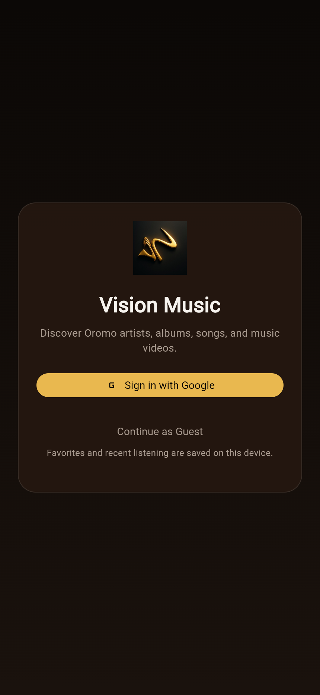
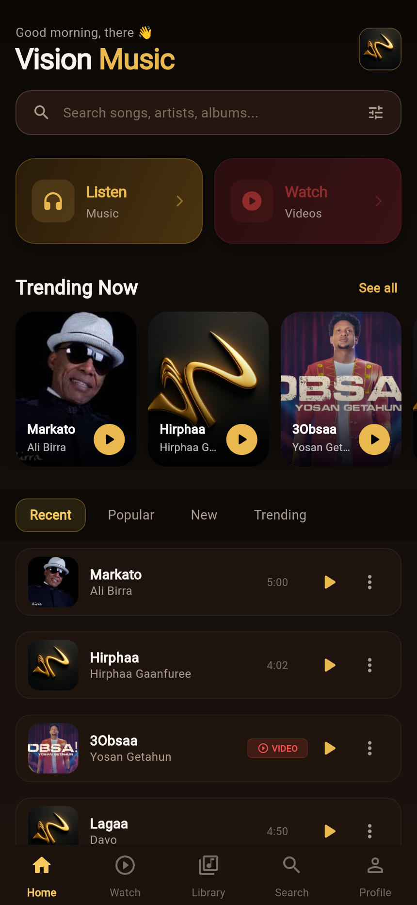
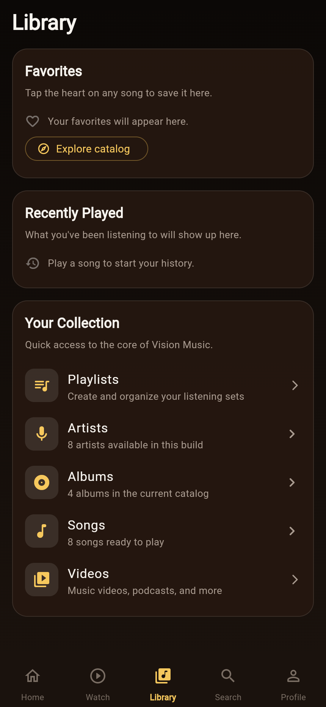
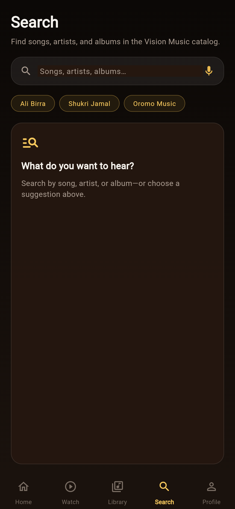

# Vision Music

[](https://github.com/Birra3324/visionmusicapp/actions/workflows/ci.yml)

Vision Music is a Flutter/Dart music streaming app for iOS, Android, macOS, and Web. It plays audio with `just_audio` and `audio_service`, and it includes playlists, search, guest access, and Google sign-in.

It is live at [https://www.visionmusic.et](https://www.visionmusic.et). The app was built under [Vision Entertainment LLC](https://vision-ent.com/), which ended mid-2026.

## Features

- Playback with `just_audio` and background controls through `audio_service`, plus a persistent mini-player and a now-playing screen
- Home, Watch, Library, Search, and Profile
- Playlists, favorites, and recently played, stored on the device
- Search by song, artist, or album
- Continue as a guest, or sign in with Google
- A bundled catalog so the app plays music on a local run while `AppConfig.useFirebaseCatalog` is off
- An optional Cloud Firestore catalog when that flag is turned on
- English, Afaan Oromo, Amharic, Arabic, French, and Spanish

On the login screen, **Continue as Guest** opens the app without a Firebase session. Favorites and recent listening stay on the device.

## Screenshots

Captured from a web build in guest mode, using the bundled catalog.

| Login | Home | Now Playing | Library | Search |
|---|---|---|---|---|
|  |  |  |  |  |

## Tech stack

| Layer | Tech |
| --- | --- |
| App | Flutter / Dart (`sdk: ^3.12.0`, Flutter `>=3.44.0`) |
| Playback | `just_audio`, `audio_service`, `audio_session` |
| State | Provider |
| Auth | Firebase Auth and Google Sign-In; guest entry needs neither |
| Data | Bundled assets by default; Cloud Firestore and Firebase Storage when the catalog flag is on |
| Local storage | `shared_preferences` |
| UI copy | `flutter_localizations` and `intl` |
| Platforms | iOS, Android, macOS, Web |

The FlutterFire client files already in the tree (`lib/firebase_options.dart`, `android/app/google-services.json`, and `GoogleService-Info.plist`) are the public client config. Signing keystores and service-account JSON stay out of git.

## Run locally

Use Flutter 3.44 or newer and a Dart SDK that satisfies `^3.12.0` (`environment` in `pubspec.yaml`). Flutter 3.47.9 with Dart 3.13.7 meets that constraint.

```bash
git clone https://github.com/Birra3324/visionmusicapp.git
cd visionmusicapp
flutter pub get
flutter run -d chrome
```

`flutter devices` lists phones, simulators, and desktop targets. `flutter run` with no `-d` picks one. Choose **Continue as Guest** on the login screen.

## Tests

From the repository root:

```bash
flutter pub get
flutter analyze --no-fatal-infos
flutter test
```

`flutter analyze` treats info-level lints as fatal by default. `--no-fatal-infos` still fails the command on warnings and errors. CI runs the same two checks on Ubuntu with the Flutter stable channel.

## Project structure

```
lib/
  main.dart                  # bootstrap, catalog load, audio session
  app/main_shell.dart        # Home, Watch, Library, Search, Profile
  features/                  # auth, library, search, profile, video
  audio/audio_handler.dart   # audio_service background handler
  audio_manager.dart         # queue, favorites, recent plays
  controllers/               # playlists
  core/services/             # catalog flag, Firebase bootstrap, media sources
  mock_songs.dart            # bundled catalog
  l10n/                      # en, om, am, ar, fr, es
assets/audio/                # tracks used by the local catalog
assets/images/
docs/screenshots/            # login, home, player, library, search
test/
android/  ios/  macos/  web/  linux/  windows/
```

Catalog audio and artwork belong to Vision Entertainment LLC.

## Author

Birra Gemedi · [birragemedi@gmail.com](mailto:birragemedi@gmail.com) · [LinkedIn](https://www.linkedin.com/in/birra-gemedi-813337199/)
